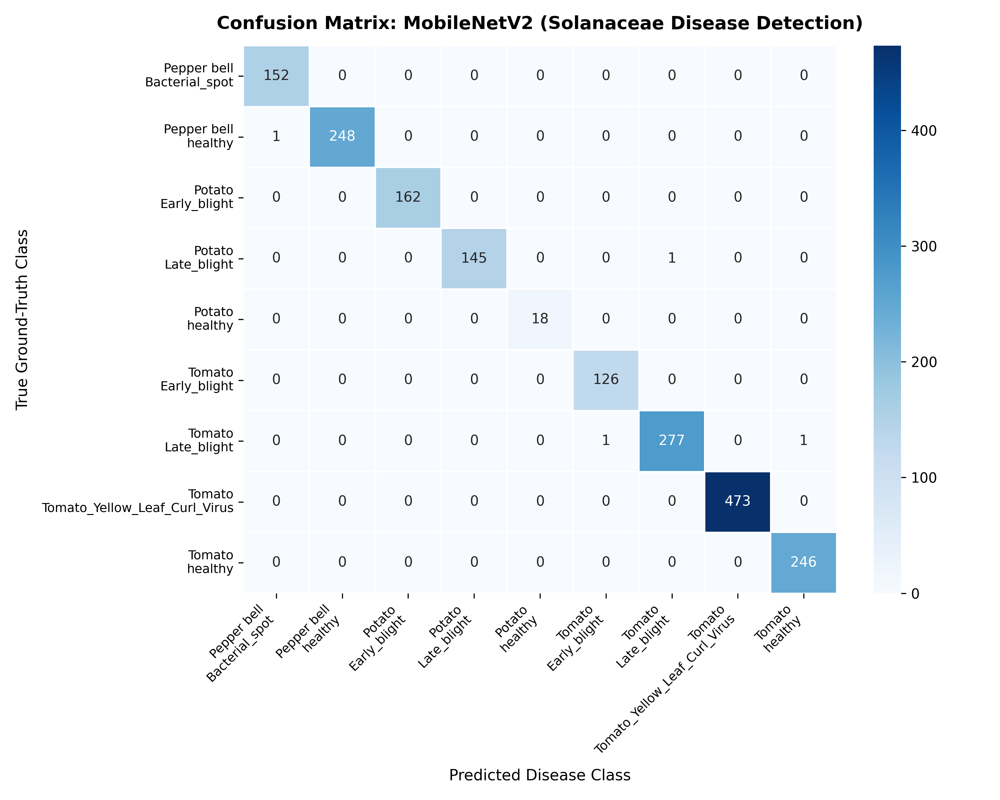

# Plant Disease Detection and Analysis for Solanaceae Crops Using Image Processing, MobileNetV2, and Grad-CAM

A dual-modality Computer Vision and Deep Learning diagnostic system developed as an engineering capstone project. The system combines classical image processing (K-Means color segmentation) with transfer learning (MobileNetV2) and explainable AI (Grad-CAM) to identify foliar diseases across the Solanaceae family (Tomato, Potato, and Bell Pepper).

---

## 1. About the Project

Solanaceae family crops—tomatoes, potatoes, and peppers—are dietary and commercial staples worldwide. However, they are highly susceptible to foliar pathogens such as *Phytophthora infestans* (Late Blight) and *Alternaria solani* (Early Blight), which can decimate an entire harvest within days if left unchecked. Smallholder farmers often lack immediate access to agricultural pathologists, leading to delayed or incorrect chemical interventions.

Standard deep learning classifiers frequently behave as uninterpretable "black boxes"—they can predict a disease label with high confidence while secretly focusing on background dirt, lighting artifacts, or greenhouse bench markers. 

To solve this, this project implements a **dual-modality inspection pipeline**:
1. **Classical IPCV (Unsupervised)**: Operates directly on pixel chromaticity in CIELAB space to isolate necrotic lesions geometrically and calculate physical disease severity percentages.
2. **Deep Learning (Supervised)**: Uses a fine-tuned MobileNetV2 network for lightweight, edge-ready classification across 9 disease classes.
3. **Explainable AI (Grad-CAM)**: Backpropagates gradients from the predicted class to the final convolutional feature maps, verifying whether the neural network's visual attention aligns with the actual physical lesion areas identified by classical segmentation.

---

## 2. Key Features

- **Classical IPCV Segmentation (OpenCV K-Means)**:
  - Converts RGB input into CIELAB color space ($L^*, a^*, b^*$).
  - Separates luminance from chromaticity so that variations in ambient field lighting do not disrupt segmentation.
  - Partitions pixels into $K=3$ clusters (Background, Healthy Foliage, Diseased Lesion) via `cv2.kmeans()`.
  - Applies morphological opening to remove impulse noise and uses bitwise-AND masking to extract isolated lesion patches and compute quantitative leaf severity:
    $$\text{Severity (\%)} = \frac{\text{Lesion Pixels}}{\text{Total Leaf Pixels}} \times 100\%$$

- **Lightweight Deep Learning (MobileNetV2)**:
  - Employs inverted residual blocks with depthwise separable convolutions (~3.5M parameters).
  - Fits easily into edge-device constraints (mobile devices or single-board computers) without sacrificing feature extraction capability.
  - Fine-tuned using differential learning rates ($0.2\times$ base LR for backbone, $2.0\times$ for classification head) and a cosine annealing schedule.

- **Explainable AI (Grad-CAM)**:
  - Hooks into MobileNetV2’s final convolutional block (`model.features[-1]`, 1280 feature channels).
  - Computes channel-wise importance weights via spatial Global Average Pooling of gradients.
  - Produces a coarse 2D localization heatmap blended with the input leaf ($0.6 \times \text{Original} + 0.4 \times \text{JET Colormap}$) to confirm model accountability.

- **Interactive Streamlit Web Dashboard**:
  - Live inspection tab with drag-and-drop image uploads or quick-demo sample selection.
  - Side-by-side 3-column diagnostic viewer: Raw Leaf vs. K-Means Segmented Lesions vs. Grad-CAM Activation.
  - Automated agronomist recommendations for each diagnosed disease.
  - Dedicated model performance tab rendering confusion matrices and classification metrics directly from saved evaluations.

---

## 3. Supported Crops and Diseases

The model classifies 9 categories from the Solanaceae family:

| # | Crop | Class Identifier | Pathogen / Condition | Category |
|---|------|------------------|----------------------|----------|
| 1 | **Bell Pepper** | `Pepper__bell___Bacterial_spot` | *Xanthomonas campestris* | Bacterial |
| 2 | **Bell Pepper** | `Pepper__bell___healthy` | Healthy leaf tissue | Healthy |
| 3 | **Potato** | `Potato___Early_blight` | *Alternaria solani* | Fungal |
| 4 | **Potato** | `Potato___Late_blight` | *Phytophthora infestans* | Oomycete / Fungal |
| 5 | **Potato** | `Potato___healthy` | Healthy leaf tissue | Healthy |
| 6 | **Tomato** | `Tomato___Early_blight` | *Alternaria solani* | Fungal |
| 7 | **Tomato** | `Tomato___Late_blight` | *Phytophthora infestans* | Oomycete / Fungal |
| 8 | **Tomato** | `Tomato___Tomato_Yellow_Leaf_Curl_Virus` | TYLCV (vector: *Bemisia tabaci*) | Viral |
| 9 | **Tomato** | `Tomato___healthy` | Healthy leaf tissue | Healthy |

---

## 4. Results & Performance

The model was trained and evaluated on a subset of 12,335 images from the PlantVillage dataset using a stratified **70% Train (8,634) / 15% Validation (1,850) / 15% Test (1,851)** split.

### Overall Benchmark Metrics
- **Evaluated Test Images**: 1,851
- **Overall Test Accuracy**: **99.78%** (1,847 / 1,851 correct)
- **Cross-Entropy Test Loss**: **0.0077**
- **Macro Average F1-Score**: **0.998**
- **Weighted Average F1-Score**: **0.998**

### Per-Class Test Set Classification Report
*(Values loaded directly from `metrics_summary.json`)*

| Class Name | Precision | Recall | F1-Score | Support (Test Images) |
|---|:---:|:---:|:---:|:---:|
| **Bell Pepper: Bacterial Spot** | 0.993 | 1.000 | 0.997 | 152 |
| **Bell Pepper: Healthy** | 1.000 | 0.996 | 0.998 | 249 |
| **Potato: Early Blight** | 1.000 | 1.000 | 1.000 | 162 |
| **Potato: Late Blight** | 1.000 | 0.993 | 0.997 | 146 |
| **Potato: Healthy** | 1.000 | 1.000 | 1.000 | 18 |
| **Tomato: Early Blight** | 0.992 | 1.000 | 0.996 | 126 |
| **Tomato: Late Blight** | 0.996 | 0.993 | 0.995 | 279 |
| **Tomato: Yellow Leaf Curl Virus** | 1.000 | 1.000 | 1.000 | 473 |
| **Tomato: Healthy** | 0.996 | 1.000 | 0.998 | 246 |
| **Overall / Weighted Average** | **0.998** | **0.998** | **0.998** | **1,851** |

### Confusion Matrix
The multiclass confusion matrix was generated using `sklearn.metrics` and rendered via Seaborn:




## 5. Project Folder Structure

```text
ipcv_project/
├── .streamlit/
│   └── config.toml          # Streamlit runtime configuration (disables module watching issues)
├── dataset/                 # Dataset folder partitioned into 9 class subdirectories
│   ├── Pepper__bell___Bacterial_spot/
│   ├── Pepper__bell___healthy/
│   ├── Potato___Early_blight/
│   ├── Potato___Late_blight/
│   ├── Potato___healthy/
│   ├── Tomato___Early_blight/
│   ├── Tomato___Late_blight/
│   ├── Tomato___Tomato_Yellow_Leaf_Curl_Virus/
│   └── Tomato___healthy/
├── app.py                   # Streamlit web application (UI, live inference, metrics rendering)
├── train.py                 # Dataset loader, 70/15/15 splitting, training loop, evaluation script
├── utils.py                 # K-Means clustering, Grad-CAM class, model builder, agro remedies
├── download_dataset.py      # Dataset integrity audit tool
├── requirements.txt         # Minimal Python library dependencies
├── classes.json             # Serialized list of class label names
├── mobilenet_tomato.pth     # Saved best model state dictionary weights
├── confusion_matrix.png     # Saved Seaborn test set confusion matrix heatmap
├── metrics_summary.json     # Saved quantitative test metrics (precision, recall, f1, loss)
└── README.md                # Project documentation and engineering manual
```

---

## 6. How to Run Locally

### Prerequisites
- Python 3.10 or higher installed
- Git installed (optional, for cloning)

### Step 1: Set Up Virtual Environment
Open your terminal in the `ipcv_project` folder:

```bash
# Windows (PowerShell)
python -m venv venv
.\venv\Scripts\Activate.ps1

# Linux / macOS
python3 -m venv venv
source venv/bin/activate
```

### Step 2: Install Required Packages
```bash
pip install -r requirements.txt
```

### Step 3: Run the Web Application
Launch the Streamlit interactive dashboard:
```bash
streamlit run app.py
```
Open your browser to `http://localhost:8501`. 
- Go to **"Live Diagnosis & Inspection"** to upload leaf images or pick from sample leaves.
- Go to **"Model Performance & Metrics"** to inspect the live confusion matrix and classification report.

### Step 4: Retrain or Evaluate the Model (Optional)
To retrain the model from scratch or re-evaluate the test split:
```bash
python train.py --epochs 10 --batch-size 16 --lr 0.0005
```
This will automatically refresh `mobilenet_tomato.pth`, `confusion_matrix.png`, and `metrics_summary.json`.

---

## 7. Limitations and Future Scope

- **Laboratory vs. Field Imagery**: PlantVillage images feature single leaves placed on flat, neutral backplates. In real-world agricultural conditions, camera feeds capture overlapping canopies, moving insects, weeds, soil, and direct sunlight glare. Integrating "in-the-wild" datasets like **PlantDoc** is the next step to improve field robustness.
- **Micro-Lesion Sensitivity**: K-Means clustering can struggle when symptoms are in the earliest stages (microscopic bacterial pinpricks $< 5$ pixels). Incorporating multi-scale feature pyramids or attention gates would help detect early-stage infections.
- **Embedded & Edge Deployment**: The current model architecture has ~3.5 million parameters. Future work involves quantizing the weights to 8-bit integers (PyTorch INT8 / ONNX Runtime) and deploying the pipeline onto a **Raspberry Pi 4 / 5** or an Android application for offline in-field scouting without cellular reception.
